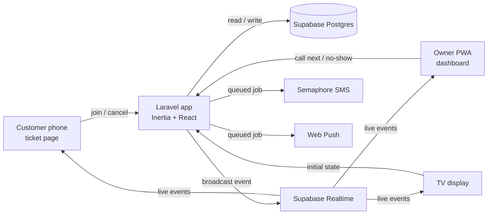

# Virtual Queue System — Plan

## Summary
A web-based virtual queue for small Philippine businesses (barbershops, clinics, small offices). Customers scan a QR code, get a ticket number on their phone, watch their live position, and get an SMS when their turn is near. The owner runs the queue from a mobile-friendly dashboard (installable as a PWA), and a TV display shows who is being served.

Shape of the solution: one Laravel monolith (Inertia + React) + Supabase Postgres + Supabase Realtime Broadcast for live updates + Semaphore for SMS.

---

## Stack
| Layer | Choice | Notes |
|---|---|---|
| Backend | Laravel 12 | Session auth, Form Requests, queued jobs, scheduler |
| Frontend | Inertia.js + React + TypeScript | Use the Laravel 12 React starter kit |
| Styling | Tailwind CSS | Mobile-first for owner and customer screens |
| Database | Supabase PostgreSQL | Laravel connects with the normal `pgsql` driver (use the direct or session-pooler connection string) |
| Real-time | Supabase Realtime **Broadcast** | Laravel sends events via Supabase's REST broadcast endpoint; React listens with `@supabase/supabase-js` |
| SMS | Semaphore (PH) | Custom Laravel notification channel; `log` driver for development |
| Push | Web Push (`laravel-notification-channels/webpush`) | Owner alerts when the PWA is closed |
| QR codes | `bacon/bacon-qr-code` | SVG QR codes for the poster and TV display (already used by Fortify for two-factor setup) |
| PWA | Hand-written `public/manifest.webmanifest` + `public/sw.js` | Installable owner dashboard; the service worker only shows push alerts (no offline cache, since running a queue needs the network). Replaces `vite-plugin-pwa` (phase 9): simpler, and no bundler compatibility risk |
| Queue driver | `database` | No Redis needed at this scale |
| Owner sign-in | Fortify + Laravel Socialite | Email and password, passkeys, two-factor codes, and "Continue with Google". Google keys live in Laravel's `.env`, not in Supabase |
| Tests | Pest | Feature tests for the core flows |
| Containers | Docker | One image for local development and production |
| Hosting | Railway | Deployed from the Dockerfile; usage-based billing with a spending limit |

Not used: NativePHP, Supabase Auth, Laravel Reverb, Redis, `vite-plugin-pwa`.

---

## Requirements & assumptions

### Core use cases (v1)
1. Customer scans a QR code, picks a service, enters a name (phone optional), and receives a ticket (e.g. `A-024`).
2. Customer sees their live position and estimated wait on a ticket page, and can cancel.
3. Owner calls the next customer, marks no-shows, and recalls a ticket from a phone.
4. Owner can open or pause the queue, and manage services and counters.
5. TV display shows "now serving" per counter and the next few numbers.
6. Customer gets an SMS when near the front and when called (if they gave a phone number).

### Scale
- One to a few businesses for the demo; each with 1–5 counters and up to ~300 tickets per day.
- A few dozen concurrent real-time connections per business.

### Constraints
- Solo developer, portfolio project, low hosting budget.
- Timezone: `Asia/Manila`. Queue numbering resets daily.

### Assumptions (change if needed)
- v1 has one **owner** account per business. The `role` column exists for adding staff later.
- Any counter can serve any service.
- Customers never log in; their ticket is identified by an unguessable UUID in the URL.

---

## Architecture



| Component | Responsibility | Why it's needed |
|---|---|---|
| Laravel app | All business logic, auth, validation, ticket numbering, API for state snapshots | Single source of truth |
| Supabase Postgres | Stores businesses, services, counters, tickets | Managed DB with backups |
| Supabase Realtime (Broadcast) | Pushes live updates to every screen | Real-time is a core requirement; avoids hosting a WebSocket server |
| Queue worker | Sends SMS, web push, and broadcasts off the request cycle | Keeps "Call next" fast |
| Scheduler | End-of-day cleanup | Daily reset of the queue |
| Semaphore | SMS to customers | PH-local SMS provider |

### Real-time design rules
- **Broadcasts are signals, not data.** Payloads contain only non-personal fields: ticket code, counter name, status, counts. Never names or phone numbers.
- **Public broadcasts carry enough data that customer pages never refetch on events.** Queue events include the ordered list of waiting ticket codes (`waiting_codes`), so each customer page computes its own position locally. This avoids a refetch storm where every waiting phone hits the server each time "Call next" is tapped.
- Only the **owner dashboard refetches** its full state (with names) from an authenticated Laravel endpoint on each event. This means no private Supabase channels are needed (Supabase private channels require Supabase Auth, which we are not using).
- Broadcast only **after the database transaction commits** (`afterCommit`).
- Every client **refetches state on reconnect and when the tab becomes visible again** (phones drop sockets when locked), with a **random 0–2 second delay** so reconnecting phones don't all hit the server at once.
- If Realtime fails, clients fall back to polling the state endpoint every 15–30 seconds, and stop polling while the page is hidden.
- Public state endpoints are **cached for 2–3 seconds** per business, so a burst of requests costs one database query.
- **Public channels can be written to by anyone** holding the publishable key (it ships in every browser). So a broadcast is never trusted for anything with real impact: news about a customer's own ticket (`ticket:{uuid}`) is confirmed by refetching before it's shown, the join page, dashboard and TV display refetch on events (a fake message must never reach a screen in the shop), and only the low-risk place-in-line view is computed from the payload (any refresh corrects it). The queue channel never carries ticket UUIDs, since a UUID is its customer's key to the ticket. (Added in phase 6.)

### Channels and events
| Channel | Listeners | Events | Payload |
|---|---|---|---|
| `queue:{business_id}` | TV display, customer pages, owner dashboard | `ticket.joined`, `ticket.called` (also on Recall, with `recalled: true`), `ticket.updated` (done, no-show, cancelled, removed), `queue.toggled`, `queue.reset` (a new day: leftover tickets closed and/or the QR code changed) | `{ ticket: { code, counter, status } \| null, queue: <public snapshot> }`; the snapshot has `waiting_count`, `waiting_codes`, `now_serving`, `average_minutes` per ticket letter and `active_counters`, so pages can work out each place in line and wait (no names, phones or ticket IDs) |
| `ticket:{ticket_uuid}` | One customer's ticket page | `ticket.called` (incl. recall), `ticket.updated` (done, no-show, cancelled) | `{ code, counter, status, recalled? }` |

Laravel sends broadcasts with a small `SupabaseBroadcaster` service: one `POST /realtime/v1/api/broadcast` with a `messages` array, from the queued `BroadcastQueueUpdate` job (dispatched after commit; the worker runs with `--sleep=1`). The server key goes in the `apikey` header; a legacy `service_role` JWT also goes in `Authorization: Bearer`, a new secret key (`sb_secret_...`) must not. The browser uses the **publishable key** only. Fallback polling runs every 20 s, only while the live connection is down.

---

## Data model

### businesses
| Field | Notes |
|---|---|
| id | PK |
| name | |
| slug | unique; used in public URLs |
| is_open | bool; when false, new joins are rejected |
| near_threshold | int, default 3; "almost your turn" SMS position |
| max_waiting | nullable int; when reached, new joins are rejected ("Queue is full") |
| join_cutoff_time | nullable time; joins close after this time each day |
| qr_token | string; required in the join URL |
| rotate_qr_daily | bool, default false; when true, `qr_token` changes every night |
| qr_token_date | date the current token is valid for; set to today when daily rotation is turned on, so the code doesn't change mid-day |
| display_token | 12 characters, no look-alike letters; the secret in the TV display link `/tv/{display_token}`. Separate from `qr_token` (which the display shows) and resettable by the owner |
| photo_path, photo_disk | nullable; the shop photo on the join page. `supabase` (public Storage bucket, `SUPABASE_STORAGE_BUCKET`) or `public` (local disk). A new random file name on every upload, so caches never show an old photo |
| is_demo | bool; the public demo's sample shop (reset hourly, never sends SMS) |
| timezone | default `Asia/Manila` |
| plan | `free` \| `basic` \| `pro` (`App\Enums\Plan`); the plan paid for, set only by `php artisan plan:set` |
| plan_expires_at | nullable; when the paid plan ends (null: it doesn't). After it, the shop is on Free |
| trial_ends_at | nullable; new shops try the trial plan (Pro) until then |

### users
Laravel default fields plus `business_id` (FK), `role` (`owner` | `staff`, enum) and `google_id` (nullable, unique; Google's account ID). `password` is nullable: owners who sign up with Google have none until they set one.

### services
| Field | Notes |
|---|---|
| id, business_id | FK |
| name | e.g. "Haircut", "Consultation" |
| prefix | e.g. `A`, `B`; unique per business |
| default_minutes | fallback for wait estimates |
| is_active | bool |

### counters
| Field | Notes |
|---|---|
| id, business_id | FK |
| name | e.g. "Counter 1", "Chair 2" |
| is_active | bool |

### tickets
| Field | Notes |
|---|---|
| id | UUID PK (used in the customer URL) |
| business_id, service_id | FK |
| counter_id | nullable FK; set when called |
| queue_date | date in business timezone |
| number | int, resets daily per service |
| code | e.g. `A-024` |
| customer_name | |
| phone | nullable, normalized to `639XXXXXXXXX` |
| status | enum: `waiting`, `called`, `done`, `no_show`, `cancelled` |
| joined_at, called_at, completed_at | timestamps for analytics |
| near_sms_sent_at, called_sms_sent_at | nullable; prevents duplicate SMS |
| idempotency_key | UUID generated once by the join form; unique |
| device_id | random ID from a long-lived browser cookie |

Constraints and indexes:
- **Unique** `(service_id, queue_date, number)` as a safety net against duplicate numbers.
- **Unique** `idempotency_key` so a repeated join submit returns the existing ticket.
- Index `(business_id, queue_date, device_id, status)` and `(business_id, queue_date, phone, status)` for the one-active-ticket checks.
- Index `(business_id, queue_date, status, joined_at)` for queue lookups.

### sms_logs
`ticket_id`, `phone`, `type` (`near` | `called`), `message`, `status` (`sent` | `failed` | `logged`), `provider_message_id`, `provider_response`, timestamps. One row per attempt.

### push_subscriptions
Created by the web push package's migration.

---

## Routes

### Public (no login)
| Method | Path | Purpose |
|---|---|---|
| GET | `/` | Landing page, with a pricing section |
| GET | `/pricing` | The plans, prices and common questions |
| GET | `/q/{business:slug}?k={qr_token}` | Join page: choose service, enter name, optional phone (only on plans with texts). Shows "Scan the QR code at the shop" if the token is missing or expired |
| POST | `/q/{business:slug}/tickets` | Create ticket, redirect to ticket page (rate-limited) |
| GET | `/t/{ticket}` | Ticket page: number, position, ETA, live updates; a chime, vibration (Android) and a 🔔 tab title when called or recalled. Browsers allow sound only after a tap (there is no sound permission pop-up): the tap on "Get my ticket" counts, otherwise the page offers a "Turn on sound" button. The chime is a generated audio file, not Web Audio, because iPhones mute Web Audio when the silent switch is on |
| POST | `/t/{ticket}/cancel` | Customer cancels |
| GET | `/tv/{display_token}` | TV "now serving" display. Its own secret link (not `/q/{slug}/display`): the display shows the current QR code, so a guessable address would let anyone join from home. Short enough to type on a TV remote |
| GET | `/tv/{display_token}/state` | JSON for the display: counters with who they're serving, next 5 codes, waiting count, join QR code (null while joining is closed). No personal data |
| GET | `/q/{business:slug}/state` | JSON snapshot without personal data (for refetch) |
| GET | `/t/{ticket}/state` | JSON snapshot for one ticket |

### Owner sign-in
Fortify's routes (`/login`, `/register`, password reset, email verification, two-factor, passkeys) plus:

| Method | Path | Purpose |
|---|---|---|
| GET | `/auth/google` | Send the owner to Google (account picker always shown). A signed-in owner comes here to confirm it's them |
| GET | `/auth/google/callback` | Sign in, link or create the account; or confirm a signed-in owner |

### Owner (auth, scoped to own business via policies)
| Method | Path | Purpose |
|---|---|---|
| GET | `/dashboard` | Today: now serving, waiting list, quick stats |
| GET | `/dashboard/state` | JSON snapshot with names, for refetch |
| POST | `/dashboard/counters/{counter}/call-next` | Call the next waiting ticket; body includes `expected_current_ticket_id` |
| POST | `/dashboard/tickets/bulk-remove` | Remove several fake or spam tickets at once |
| POST | `/dashboard/tickets/{ticket}/done` | Mark done |
| POST | `/dashboard/tickets/{ticket}/no-show` | Mark no-show |
| POST | `/dashboard/tickets/{ticket}/recall` | Re-announce a called ticket |
| POST | `/dashboard/queue/toggle` | Open or pause the queue |
| resource | `/dashboard/services` | CRUD services |
| resource | `/dashboard/counters` | CRUD counters |
| GET | `/dashboard/stats?days=1\|7\|30\|90\|180\|365` | Today or the last days (shop's timezone), up to the plan's history (longer periods lead to Plan & billing): served of joined, average wait (joined to called), average service (called to done), no-shows with rate, busiest hours (joins per local hour), served per day (per week over 3 and 6 months, per month over 12), by service and by counter. No names or phones |
| GET | `/dashboard/plan` | Plan & billing: the plan, this month's usage, the plans and how to pay |
| GET | `/dashboard/qr` | Printable QR poster for the join page (warns when the QR code changes nightly) |
| GET | `/dashboard/display` | TV display link, setup steps, reset |
| POST | `/dashboard/display/reset` | New TV link; screens on the old one show "This TV link no longer works" |
| POST | `/dashboard/push-subscriptions` | Turn alerts on for a device. Only real push services' endpoints are accepted (FCM, Mozilla, Apple, Windows), since the server sends requests to them |
| DELETE | `/dashboard/push-subscriptions` | Turn alerts off for a device (only the owner's own) |
| POST | `/dashboard/push-subscriptions/test` | Send a test alert |
| GET | `/settings/alerts` | Alerts on this device, install the app, which alerts the shop settings allow |

---

## Key flows

### 1. Customer joins (ticket numbering must never duplicate)
1. If a ticket with the submitted `idempotency_key` already exists, redirect to it and stop (handles double-taps and slow-network resubmits).
2. Validate the request. Reject if:
   - the QR token is missing or doesn't match the business's current `qr_token`,
   - `business.is_open` is false or the current time is past `join_cutoff_time`,
   - the service is inactive,
   - the waiting count has reached `max_waiting` ("Queue is full, please try again later").
3. Normalize the phone number. If the same phone **or** the same `device_id` already has an active ticket at this business today, redirect to that ticket instead of creating a new one.
4. In a DB transaction: lock the service row (`lockForUpdate`), re-check `max_waiting`, compute `max(number) + 1` for `(service_id, queue_date)`, and insert the ticket with `code = prefix-number` (zero-padded to 3 digits).
5. After commit: broadcast `ticket.joined` on `queue:{business_id}`, and queue a web push to the owner (plus "almost full" when this join reached that point; the waiting count is taken under the join lock, so it fires exactly once).
6. Save the ticket UUID in the browser's `localStorage` and redirect to `/t/{uuid}`. If the customer scans the QR code again later, the join page shows "You already have ticket A-024" with a link back.

The join page shows the current estimated wait **before** joining, so customers can decide whether to wait.

### 2. Owner taps "Call next"
1. Acquire an atomic lock for the counter (`Cache::lock("counter:{id}", 10)`). If it is already held, return "Still processing, please wait."
2. Compare the request's `expected_current_ticket_id` with the counter's actual current ticket. If they differ (an earlier tap already went through), reject with "Already called A-025" and return fresh state. This stops a double-tap from calling two customers.
3. In a DB transaction: mark the counter's current `called` ticket as `done` (if any). One tap per customer, so the button says so while someone is at the counter ("Done A-003 · Call next") and the toast names both ("A-003 is done. Calling A-004 to Chair 1."): a customer who never came should get No-show first, or Stats count them as served.
4. Select the oldest `waiting` ticket for today using `lockForUpdate()->skipLocked()` so two counters never grab the same ticket.
5. Set `status = called`, `counter_id`, `called_at`. Release the counter lock.
6. After commit:
   - Broadcast `ticket.called` on `queue:{business_id}` and `ticket:{uuid}`.
   - Queue the "called" SMS if the ticket has a phone and `called_sms_sent_at` is null.
   - Queue the "near" SMS for every waiting ticket now within position `near_threshold` that has a phone and a null `near_sms_sent_at`.
7. If no one is waiting, return a friendly "Queue is empty" message.

### 3. Position and estimated wait
- Position = count of `waiting` tickets for the same business and day with an earlier `joined_at`, plus one.
- Average service time = mean of `(completed_at - called_at)` for the last 10 `done` tickets of that service; fall back to `default_minutes`.
- Wait = the average service times of the people ahead (each for their own service, read from the ticket letter) ÷ number of active counters (rounded up, shown as a range like "10–15 min"). Your own service time isn't counted: the wait is until you're called, so next in line sees "Under 5 min", and everyone joining now sees the same wait whatever service they pick. (Changed in phase 4 from "position × average service time", which counted the customer's own service and assumed everyone ahead had the same service.)

### 4. End of day
- `queue:end-day` runs hourly and, for each business, only touches days that have ended in that business's timezone, so it is safe to repeat and catches up after a missed run. It marks leftover `waiting` tickets as `cancelled` and leftover `called` tickets as `no_show`.
- Numbering resets automatically because it is keyed on `queue_date`.
- The same command rotates each business's `qr_token` (only for businesses with daily rotation turned on).
- It broadcasts `queue.reset` with the closed tickets, so ticket pages and the TV catch up. A ticket from a day that ended says "The queue has closed for the day" rather than "You left" or "You missed your turn" (the owner may simply have forgotten to press Done).

---

## Customer identity (no login)
- Customers never create accounts. The ticket's UUID link is their identity; only someone holding it can view or cancel the ticket.
- The ticket UUID is saved in `localStorage`, and a long-lived `device_id` cookie is set on first visit.
- The "near" SMS includes the ticket link so customers can reopen it from any device.
- Only the owner logs in.

## Duplicate-request protection
| Risk | Protection |
|---|---|
| Customer double-taps "Join" | Button disabled while processing; idempotency key returns the existing ticket |
| Customer joins twice (new tab, no phone) | One active ticket per `device_id` and per phone per business per day |
| Two customers join at the same moment | Service row lock + unique `(service_id, queue_date, number)` |
| Owner double-taps "Call next" | Button disabled while processing; per-counter atomic lock; `expected_current_ticket_id` check |
| Two counters call next at the same moment | `lockForUpdate()->skipLocked()` on the waiting ticket |
| Done / No-show / Cancel tapped twice | Status-checked updates (e.g. only `called → done`); a repeat does nothing |
| SMS job retried | `near_sms_sent_at` / `called_sms_sent_at` guards |

## Traffic and capacity protection
- **Queue capacity:** `max_waiting` per business; the join page shows "Queue is full" when reached.
- **Join cutoff:** `join_cutoff_time` stops new joins before closing.
- **Wait shown before joining:** customers see the estimated wait first and can decide not to join.
- **Spam:** rate limits per IP and phone, honeypot field, one active ticket per device/phone, and a QR token in the join URL (optionally rotated daily, so only people who scanned the code that day can join). Owner can bulk-remove fake tickets.
- **Refetch storms:** public broadcasts include `waiting_codes` so customer pages update locally; public state endpoints cached 2–3 seconds; randomized reconnect delay; slow polling fallback paused when hidden.
- **Supabase Realtime limits:** the free tier caps concurrent connections and messages. Check current limits before demos; upgrade or switch to Pusher if they become a problem.

## SMS (Semaphore)
- Custom notification channel `SemaphoreChannel` that sends through the `SemaphoreClient` service (Laravel's HTTP client). Texts are queued notifications (`TicketNearTurn`, `TicketCalled`), dispatched after the database commits.
- Driver switch in `.env`: `SMS_DRIVER=log` (development, writes to the log and `sms_logs`) or `SMS_DRIVER=semaphore`.
- At most two texts per ticket: "near" and "called". `QueueTexts` claims each in its `*_sms_sent_at` column (an atomic `UPDATE ... WHERE ... IS NULL`) before queueing it, so repeated taps, retries and Recall never send it again.
- "Near" goes to every waiting customer within `near_threshold` of the front after a call, not only the one exactly at that position: two counters calling at once can move the queue past it. (Changed in phase 8.)
- Only the "near" text has the ticket link. "Called" stays short so it fits one SMS and goes out fast. (Changed in phase 8.)
- A text is dropped if it no longer applies when the worker gets to it (e.g. the customer cancelled, or was already served).
- Retried only when Semaphore answered with a server error or rate limit (nothing went out). No answer at all is never retried, since the text may have gone out: customers never get the same text twice.
- Messages are plain ASCII ("Peña" becomes "Pena") and at most 160 characters, shortening the shop name if needed, so each costs one SMS credit. One character outside the basic SMS alphabet would switch the whole text to 70-character parts.
- `SEMAPHORE_SENDER_NAME` only once Semaphore approves it; empty sends as Semaphore's default sender (an unapproved name makes every text fail).
- Log every attempt in `sms_logs` (`sent`, `failed` or `logged`), never with the API key.
- Messages stay short and in plain English, e.g. "Hi Ana, 2 people ahead of you at Juan's Barbershop (A-024). Please head back now. <ticket link>" and "A-024, please proceed to Chair 2 at Juan's Barbershop."

## PWA
- A manifest (`name`, icons, `start_url: /dashboard`, `display: standalone`) and a small service worker for push alerts, both static files in `public/`. Only owner and sign-in pages link the manifest, so customers and the TV are never offered to install the app.
- A dashboard banner offers "Turn on alerts" (and "Install app" where the browser allows it) until alerts are on for that device or it's dismissed. On iPhone, web push only works from the Home Screen app on iOS 16.4 or later; the banner and Settings > Alerts explain this. Push also needs https (or localhost).
- Web push to the owner (all their devices with alerts on), as queued notifications in `App\Notifications\OwnerAlerts`:
  - **Customer joined**: "A-012 joined" / "Ana, Haircut. 5 waiting." Same tag, so they replace each other instead of piling up.
  - **Queue almost full**: when the waiting line reaches `max_waiting - max(1, ceil(max_waiting × 10%))` (30 → 27, 10 → 9). Only for shops with a maximum.
  - **Join cutoff in 30 minutes**: `queue:cutoff-reminders` runs every minute and sends it once a day per shop (a cache key), in the half hour before `join_cutoff_time`, while the queue is open; if the scheduler missed the exact minute it catches up ("in 8 minutes"). Only for shops with a cutoff.
- Expired subscriptions are deleted when the push service says so.
- The customer ticket page works in a normal browser; no install needed.

## Security
- Policies ensure owners only act on their own business, services, counters, and tickets.
- Public state endpoints and broadcasts never include names or phone numbers.
- Rate-limit ticket creation per IP and per phone; add a honeypot field to the join form.
- When `rotate_qr_daily` is on, the QR token changes every night (scheduled command). Because a printed poster would go stale, the TV display shows the current QR code (it does in every mode, while joining is open); businesses that only use a printed poster keep rotation off.
- The TV display link has its own secret token, since the display shows the QR code. The owner can reset it.
- Supabase service-role key lives only in Laravel's `.env`; the browser gets only the anon key.
- Google sign-in: accounts are matched by Google ID, then by email. Google has verified the email, so an existing **verified** account with that email is linked; an **unverified** one is refused (whoever created it never proved they own the email, and linking would let them back in with its password). Owners with two-factor codes still enter one after Google.
- Owners without a password confirm sensitive actions (security settings, deleting the account) with the same Google account instead.

---

## Deployment (Docker + Railway)

### Docker image
- One `Dockerfile` (multi-stage):
  1. **Node stage:** `npm ci && npm run build` to compile Vite assets. Vite variables (`VITE_SUPABASE_URL`, `VITE_SUPABASE_ANON_KEY`) must be available **at build time**, so pass them as build arguments.
  2. **Composer stage:** `composer install --no-dev --optimize-autoloader`.
  3. **Runtime stage:** PHP 8.3+ with Nginx + PHP-FPM (a Laravel-friendly base image such as `serversideup/php` is fine), extensions `pdo_pgsql`, `bcmath`, `intl`, `opcache`.
- **supervisord** runs three processes in the one container:
  - Nginx + PHP-FPM (web)
  - `php artisan queue:work --tries=3 --max-time=3600`
  - `php artisan schedule:work`
- Nginx listens on the `PORT` environment variable that Railway provides.
- Container start script: `php artisan config:cache && php artisan route:cache && php artisan view:cache`, then start supervisord.
- Add a `.dockerignore` (exclude `node_modules`, `vendor`, `.env`, `storage/logs`, `.git`).

### Local development
- `docker-compose.yml` with the app image and a local **Postgres** container, so test data stays out of Supabase. The image uses its own `pilaph_docker` database: its queue worker would otherwise take jobs from `composer run dev` (found in phase 7).
- Run `npm run dev` on the host for hot reload, or as a separate compose service.
- Use a separate **Supabase project** for development realtime testing, never the production one.

### Railway setup
- **One service** built from the repo's `Dockerfile` (web, worker, and scheduler bundled to keep usage cost low). Split the worker into its own Railway service later if job volume grows.
- Settings live in `railway.json` (config as code): Dockerfile build, **pre-deploy command** `php artisan migrate --force`, health check `/up`, 1 replica, no sleeping, restart on failure. Region, domain, variables and the spending limit are set in the dashboard; `docs/deploy.md` is the step-by-step guide.
- **Health check path:** `/up` (Laravel's built-in health route).
- **Region:** pick the one closest to the Philippines that Railway offers.
- **Keep app sleeping / serverless mode off**, so customers never hit a cold start and the scheduler keeps running.
- **Set a spending limit and usage alerts** in Railway's billing settings.
- Add a custom domain later; Railway provides HTTPS automatically.
- In Laravel, trust Railway's proxy (`trustProxies(at: '*')` in `bootstrap/app.php`) so generated URLs use `https`.

### Environment variables
| Variable | Notes |
|---|---|
| `APP_ENV=production`, `APP_DEBUG=false`, `APP_KEY`, `APP_URL` | Standard Laravel |
| `APP_TIMEZONE=Asia/Manila` | |
| `DB_CONNECTION=pgsql`, `DB_HOST`, `DB_PORT`, `DB_DATABASE`, `DB_USERNAME`, `DB_PASSWORD` | Supabase direct or session-pooler connection; `DB_SSLMODE=require` |
| `QUEUE_CONNECTION=database` | |
| `CACHE_STORE=database` | Supports the atomic locks used by "Call next" |
| `SESSION_DRIVER=database` | |
| `LOG_CHANNEL=stderr` | Logs appear in Railway's log viewer |
| `SUPABASE_URL`, `SUPABASE_SERVICE_ROLE_KEY` | Server only; used by `SupabaseApi` (Realtime broadcasts, Storage) |
| `SUPABASE_STORAGE_BUCKET` | Public bucket for shop photos (`shop-photos`); empty keeps them on the local disk |
| `DEMO_ENABLED` | `true` shows "Try the demo" |
| `MAIL_MAILER=resend`, `RESEND_API_KEY`, `MAIL_FROM_ADDRESS` | Verification and password-reset emails through Resend's API (`resend/resend-php`); the from address must be on a domain verified in Resend. Any SMTP service works too |
| `VITE_SUPABASE_URL`, `VITE_SUPABASE_ANON_KEY` | Build arguments for the frontend |
| `GOOGLE_CLIENT_ID`, `GOOGLE_CLIENT_SECRET` | "Continue with Google" (hidden when empty). In Google Cloud Console, add `<APP_URL>/auth/google/callback` as an authorized redirect URI for every domain |
| `SMS_DRIVER` | `log` or `semaphore` |
| `SEMAPHORE_API_KEY`, `SEMAPHORE_SENDER_NAME` | |
| `VAPID_PUBLIC_KEY`, `VAPID_PRIVATE_KEY` | Web push |
| `PAYMENT_GCASH_NUMBER`, `PAYMENT_MAYA_NUMBER`, `PAYMENT_ACCOUNT_NAME`, `PAYMENT_CONTACT` | Shown on Plan & billing: where owners pay and send the receipt. All empty: "Paid plans open soon" |

Keep `.env.example` in sync with this table.

---

## Build phases (do these in order)
1. **Setup**: Laravel 12 React starter kit, Dockerfile + `docker-compose.yml` with local Postgres, Pest, `.env.example` with all keys from the Deployment section.
2. **Core models**: migrations, enums, models, factories, and policies for businesses, services, counters, tickets.
3. **Owner setup screens**: business settings, services CRUD, counters CRUD.
4. **Customer join + ticket page**: join form with QR token, idempotency key, device cookie, capacity and cutoff checks; numbering transaction; ticket page with position and ETA (polling only at first).
5. **Owner dashboard**: today view, call next (with counter lock and expected-ticket check), done, no-show, recall, bulk remove, open/pause queue. Mobile-first layout with large tap targets and buttons disabled while processing.
6. **Real-time**: `SupabaseBroadcaster` service, after-commit broadcasts, React `useQueueChannel` hook, refetch on reconnect and visibility change, polling fallback.
   - Added after phase 6: **Google sign-in** for owners (Socialite), including confirming with Google and setting a first password.
7. **TV display**: large "now serving" per counter plus the next 5 codes, the join QR code, a highlight and optional chime when a number is called (or recalled), full screen and keep-awake. Also done in this phase: the printable QR poster (moved up from phase 10) and the end-of-day command (needed for the nightly QR change).
8. **SMS**: Semaphore channel, log driver, near/called logic, `sms_logs`.
9. **PWA + web push**: manifest, service worker, install banner, owner push alerts.
10. **Stats**: stats page (the QR poster was done in phase 7). Charts are plain HTML bars, so no chart library is needed.
11. **Demo polish**: shop photo on the join page (from the Node version; needs Supabase Storage, since Railway's disk is wiped on every deploy), seeder with a sample barbershop, realistic Filipino names, and a live-looking queue; "Login as demo owner" button; README with screenshots; deploy to Railway connected to the production Supabase project.
    - Done as: a PilaPH landing page (replacing the starter kit's) with real product shots of the demo in device frames (`public/images/landing`, WebP, about 120 KB in all; below-the-fold images load lazily); `ResetDemoShop` builds Juan's Barbershop (4 services, 3 chairs, 14 days of history, 2 being served and 6 waiting) for `db:seed`, `demo:reset` (hourly while `DEMO_ENABLED`) and the first "Try the demo". The demo account has no password (the button is the only way in), its email is reserved, and `ProtectDemoAccount` blocks password, email, two-factor, passkey, account deletion, push alerts and photo uploads; its shop never texts. Photos are shrunk to 1600 px JPEGs in the browser before upload (which also drops their GPS metadata). Deploy: `railway.json`, `docs/deploy.md`, and `laravel` merged into `main` through a pull request.

12. **Plans and data retention**: a free plan and two paid ones, so busy shops pay for what they use, and data stays small.
    - **Plans** (`config/plans.php`, the only place prices and limits live):

      | | Free | Basic ₱299/mo | Pro ₱799/mo |
      |---|---|---|---|
      | Counters switched on at once | 1 | 3 | no limit |
      | Customers per calendar month | 300 | no limit | no limit |
      | SMS per calendar month | none (no phone field) | 300 | 1,000 |
      | History kept (and longest stats period) | 30 days | 6 months | 12 months |
      | Shop photo, no "PilaPH" name on customer pages, TV and poster | no | yes | yes |

    - **Trial**: every new shop (and every shop that existed before plans) gets 14 days of Pro, with 50 texts instead of 1,000 since each text costs. Then Free, by itself; nothing is charged or deleted.
    - **The plan in effect** (`Business::currentPlan()`): a paid plan until `plan_expires_at`, else the trial, else Free. The demo shop is always Pro. Limits are checked where things happen: `StoreCounterRequest`/`UpdateCounterRequest` (switching on a counter), `CallNextTicket` (counters past the limit after a downgrade are locked; the oldest keep working), `CreateTicket` (the monthly limit, and no phone number kept on a plan without texts), `QueueTexts` (stops at the month's texts, the called customer first; a soft limit, two counters at once can go one over), `UpdateShopPhotoRequest`, and `StatsController` (periods within the plan's history).
    - **Monthly limits** (customers and texts) count by calendar month in the shop's timezone and reset on the 1st. Customers are counted by queue date; texts by the `*_sms_sent_at` claims on the month's tickets (a claim counts even if Semaphore then fails).
    - **Monthly customer limit**: reaching it never closes joining in the middle of a day: joining closes from the next day (`joinClosedReason` = `monthly_limit`) until the 1st. Customers see only "Online joining is closed for now. Please ask the staff." (never the shop's plan); the TV shows the same.
    - **Texts**: on a plan without texts, or once the month's texts are used up, the join page has no phone field. The called customer's text goes first, then the near-turn ones.
    - **Counters after a downgrade**: the oldest active counters (by when they were added) up to the limit keep working; the others show "Locked" on the dashboard and can't Call next, but can still finish the customer they have (Done, No-show, Recall). Switching counters off frees places.
    - **Photo after a downgrade**: kept, but hidden from customers until the shop is on a plan with photos again.
    - **Owners see it**: a banner on owner pages (`PlanUsage::notice`) with one message, the first that applies, in this order: (1) joining closed or closing tomorrow for the monthly limit, (2) locked counters, (3) a paid plan that ended (for 30 days), (4) the trial or paid plan ending within 5 days, (5) texts used up or at 80%, (6) customers at 80%, (7) the trial ended in the last 7 days. Also a **Plan & billing** page (`/dashboard/plan`) with this month's usage, the plans and how to pay; locked periods on Stats; the limit on Counters.
    - **Everyone sees it**: a pricing section on the landing page and `/pricing`, both from `Plan::catalog()`.
    - **Payments are manual for now**: owners send GCash or Maya (`PAYMENT_*` variables) with their shop's link name in the message, and the admin runs `php artisan plan:set {link name or owner email} basic --months=1`. Renewing the same plan early adds the months after the current end date. `plan:set … free` ends a plan or trial now; `--forever` gives a plan with no end date. `php artisan plan:list` shows every shop's plan, end date and this month's customers and texts. Later: PayMongo or Xendit (GCash, Maya, cards) with webhooks calling the same code as `plan:set`.
    - **Retention** (`data:prune`, nightly at 3:15 AM): customer names and phone numbers are erased 7 days after their queue day, and the texts sent to them (which hold both) are deleted; counts and times stay for the stats. Tickets older than the plan's history are deleted in batches of 1,000. After a paid plan ends, its longer history is kept for 30 more days, so renewing late loses nothing. It also removes expired database cache rows (the join rate limiter leaves one per visitor). Also nightly: `queue:prune-failed --hours=168` and `auth:clear-resets`.
    - **Changing prices or limits**: edit `config/plans.php` only. Every shop gets the new limits at once (there are no per-shop limits), and the pricing pages update themselves.
    - **Trying it locally**: `php artisan plan:set {link name} free|basic|pro --months=1` switches a shop between plans; `php artisan data:prune` runs the clean-up now (the scheduler only runs while `php artisan schedule:work` does; in production it always runs). Checked on 2026-10-08 with one test shop per plan and state: each plan's limits, banner, join page and stats periods behaved as above, and `data:prune` deleted exactly the tickets past each plan's history (no soft deletes: the rows are gone) and erased names and numbers older than 7 days.
    - **Known gaps**: the text limit can go one over when two counters call at the same moment; an owner could get a second trial by signing up again with another email.
    - Not done yet: invoices or receipts, automatic payment, a reminder email or push before a plan ends (the banner covers it), per-shop custom limits.

## Tests (Pest)
- Two simultaneous joins never get the same number.
- Two counters calling next at the same time never get the same ticket.
- Position and ETA calculations.
- Near/called SMS are sent once only, and not at all without a phone.
- Owners cannot access another business's data.
- Joining fails when the queue is paused, full (`max_waiting`), past `join_cutoff_time`, or with a wrong QR token.
- Submitting the join form twice with the same idempotency key creates only one ticket.
- The same device or phone cannot hold two active tickets at one business.
- A double "Call next" with a stale `expected_current_ticket_id` is rejected and calls no one.
- Repeating Done / No-show on the same ticket changes nothing.
- Public broadcasts and public state endpoints never contain names or phone numbers.
- The TV display needs its secret link, and a reset link stops working.
- End of day closes only past days' tickets and rotates the QR code once per day.
- Plans: the plan in effect (paid, ended, trial, demo), each limit, the banner's messages, `plan:set` and `plan:list`, and `data:prune` (erasing after 7 days, history per plan, the grace period after a plan ends).

## Coding conventions (for the AI assistant)
- TypeScript in all React components; shared types in `resources/js/types`.
- Business logic in single-purpose Action classes (e.g. `CreateTicket`, `CallNextTicket`); controllers stay thin.
- Validation in Form Requests; PHP enums for ticket status and user role.
- Do not add packages beyond those listed in the Stack section without asking first.
- Build one phase at a time and stop for review after each phase.

### Code structure
Use both Actions and Services, each for its own job. Avoid one large `TicketService` with every ticket method (it becomes a hard-to-test god class), and don't add a repository layer on top of Eloquent.

```
app/
├── Actions/                    one class, one public method: execute()
│   ├── CreateBusiness.php      first-run shop setup (unique permanent slug)
│   ├── CreateTicket.php        join flow (locks, numbering, idempotency)
│   ├── CancelTicket.php        customer leaves the queue
│   ├── CallNextTicket.php      counter lock + expected-ticket check
│   ├── FinishTicket.php        done or no-show (only from called)
│   ├── RecallTicket.php
│   ├── BulkRemoveTickets.php
│   ├── ToggleQueue.php
│   ├── FindOrCreateGoogleOwner.php  Google sign-in: link by verified email or create
│   ├── ResetDisplayLink.php    new TV display link
│   └── RunEndOfDayCleanup.php  close past days, rotate daily QR codes
├── Services/                   outside systems and shared calculations
│   ├── SupabaseBroadcaster.php POST to Supabase Realtime
│   ├── SemaphoreClient.php     Semaphore HTTP API
│   ├── QueueEstimator.php      wait-time calculation (easy to unit-test)
│   ├── PublicQueueState.php    cached snapshot without personal data
│   ├── DisplayState.php        what the TV shows (counters, next codes, join QR)
│   ├── JoinQrCode.php          join link with QR token, drawn as an SVG
│   ├── QueueTexts.php          who gets a text when the queue moves (claims *_sms_sent_at)
│   ├── ShopStats.php           the stats page's numbers, in the shop's timezone
│   ├── OwnerQueueState.php     dashboard view with names (never phones)
│   └── OwnerAlerts.php         which push alerts to send, and when
├── Notifications/
│   ├── Channels/SemaphoreChannel.php   uses SemaphoreClient (or the log driver)
│   ├── TicketText.php                  base: queued, plain ASCII, 160 characters
│   ├── TicketNearTurn.php              "2 people ahead of you" SMS
│   ├── TicketCalled.php                "please proceed to Chair 2" SMS
│   └── OwnerAlerts/                    owner web push: CustomerJoined, QueueAlmostFull, JoinCutoffSoon, TestAlert
├── Enums/                      TicketStatus, UserRole, SmsType, SmsStatus
├── Models/                     Business, Service, Counter, Ticket, SmsLog
├── Policies/                   owners only touch their own business
├── Http/
│   ├── Controllers/            thin: validate, call one Action, return a response
│   └── Requests/               Form Requests (JoinQueueRequest, StoreServiceRequest, ...)
└── Console/Commands/           EndQueueDay (queue:end-day, hourly), SendCutoffReminders (queue:cutoff-reminders, every minute)
```

| Question | Where it goes |
|---|---|
| Is it something the business does ("call next", "join queue")? | Action |
| Does it talk to an outside API? | Service |
| Is it a calculation reused in several places? | Service (or a small support class) |
| Is it validating input? | Form Request |
| Is it "who may do this"? | Policy |
| Is it a message to a person (SMS, push)? | Notification |

Naming: `App\Models\Service` is the business's service (Haircut, Consultation). Classes in `App\Services` get descriptive names (`SupabaseBroadcaster`, `SemaphoreClient`) so the two never get confused.

---

## Not doing in v1
- Native mobile app (NativePHP) — the PWA covers the owner's needs.
- Customer accounts or login.
- Staff accounts (column exists; feature later).
- Appointments or bookings (walk-in queue only).
- Multi-language UI (English first; Tagalog/Cebuano later).
- Online payments (owners pay by GCash or Maya and the plan is switched on by hand; see phase 12).

## Growth path
- When a business needs helpers on counters, enable `staff` role with limited permissions.
- When counters need to serve specific services only, add a `counter_service` pivot.
- When SMS costs grow, add WhatsApp/Messenger or rely more on web push.
- When Supabase Realtime limits are reached, switch broadcasting to Pusher or self-hosted Reverb (the "signals + refetch" design keeps this swap small).
- When the free Supabase project pausing affects demos, add a keep-alive ping or move to a paid tier.
- When queued jobs slow down web requests or Railway usage grows, split the queue worker into its own Railway service using the same image with a different start command.

## Open questions
- App name and branding.
- Should customers see their estimated wait as a range or a single number?
- Should the TV display call numbers aloud (text-to-speech) in a later version?
