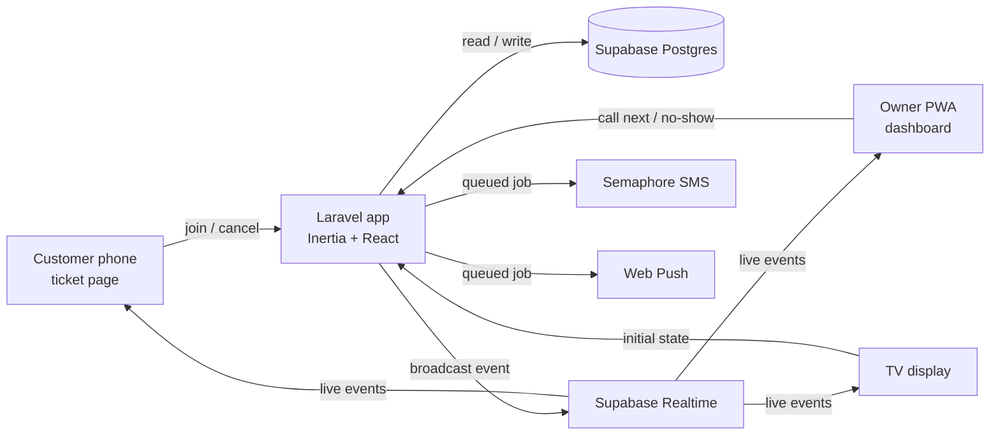

# Virtual Queue System — Plan

## Summary
A web-based virtual queue for small Philippine businesses (barbershops, clinics, small offices). Customers scan a QR code, get a ticket number on their phone, watch their live position, and get an SMS when their turn is near. The owner runs the queue from a mobile-friendly dashboard (installable as a PWA), and a TV display shows who is being served.

Shape of the solution: one Laravel monolith (Inertia + React) + Supabase Postgres + Supabase Realtime Broadcast for live updates + Semaphore for SMS.

---

## Stack
| Layer | Choice | Notes |
|---|---|---|
| Backend | Laravel 12 | Session auth, Form Requests, queued jobs, scheduler |
| Frontend | Inertia.js + React + TypeScript | Use the Laravel 12 React starter kit |
| Styling | Tailwind CSS | Mobile-first for owner and customer screens |
| Database | Supabase PostgreSQL | Laravel connects with the normal `pgsql` driver (use the direct or session-pooler connection string) |
| Real-time | Supabase Realtime **Broadcast** | Laravel sends events via Supabase's REST broadcast endpoint; React listens with `@supabase/supabase-js` |
| SMS | Semaphore (PH) | Custom Laravel notification channel; `log` driver for development |
| Push | Web Push (`laravel-notification-channels/webpush`) | Owner alerts when the PWA is closed |
| PWA | `vite-plugin-pwa` | Manifest + service worker, installable owner dashboard |
| Queue driver | `database` | No Redis needed at this scale |
| Owner sign-in | Fortify + Laravel Socialite | Email and password, passkeys, two-factor codes, and "Continue with Google". Google keys live in Laravel's `.env`, not in Supabase |
| Tests | Pest | Feature tests for the core flows |
| Containers | Docker | One image for local development and production |
| Hosting | Railway | Deployed from the Dockerfile; usage-based billing with a spending limit |

Not used: NativePHP, Supabase Auth, Laravel Reverb, Redis.

---

## Requirements & assumptions

### Core use cases (v1)
1. Customer scans a QR code, picks a service, enters a name (phone optional), and receives a ticket (e.g. `A-024`).
2. Customer sees their live position and estimated wait on a ticket page, and can cancel.
3. Owner calls the next customer, marks no-shows, and recalls a ticket from a phone.
4. Owner can open or pause the queue, and manage services and counters.
5. TV display shows "now serving" per counter and the next few numbers.
6. Customer gets an SMS when near the front and when called (if they gave a phone number).

### Scale
- One to a few businesses for the demo; each with 1–5 counters and up to ~300 tickets per day.
- A few dozen concurrent real-time connections per business.

### Constraints
- Solo developer, portfolio project, low hosting budget.
- Timezone: `Asia/Manila`. Queue numbering resets daily.

### Assumptions (change if needed)
- v1 has one **owner** account per business. The `role` column exists for adding staff later.
- Any counter can serve any service.
- Customers never log in; their ticket is identified by an unguessable UUID in the URL.

---

## Architecture



| Component | Responsibility | Why it's needed |
|---|---|---|
| Laravel app | All business logic, auth, validation, ticket numbering, API for state snapshots | Single source of truth |
| Supabase Postgres | Stores businesses, services, counters, tickets | Managed DB with backups |
| Supabase Realtime (Broadcast) | Pushes live updates to every screen | Real-time is a core requirement; avoids hosting a WebSocket server |
| Queue worker | Sends SMS, web push, and broadcasts off the request cycle | Keeps "Call next" fast |
| Scheduler | End-of-day cleanup | Daily reset of the queue |
| Semaphore | SMS to customers | PH-local SMS provider |

### Real-time design rules
- **Broadcasts are signals, not data.** Payloads contain only non-personal fields: ticket code, counter name, status, counts. Never names or phone numbers.
- **Public broadcasts carry enough data that customer pages never refetch on events.** Queue events include the ordered list of waiting ticket codes (`waiting_codes`), so each customer page computes its own position locally. This avoids a refetch storm where every waiting phone hits the server each time "Call next" is tapped.
- Only the **owner dashboard refetches** its full state (with names) from an authenticated Laravel endpoint on each event. This means no private Supabase channels are needed (Supabase private channels require Supabase Auth, which we are not using).
- Broadcast only **after the database transaction commits** (`afterCommit`).
- Every client **refetches state on reconnect and when the tab becomes visible again** (phones drop sockets when locked), with a **random 0–2 second delay** so reconnecting phones don't all hit the server at once.
- If Realtime fails, clients fall back to polling the state endpoint every 15–30 seconds, and stop polling while the page is hidden.
- Public state endpoints are **cached for 2–3 seconds** per business, so a burst of requests costs one database query.
- **Public channels can be written to by anyone** holding the publishable key (it ships in every browser). So a broadcast is never trusted for anything with real impact: news about a customer's own ticket (`ticket:{uuid}`) is confirmed by refetching before it's shown, the join page and dashboard refetch on events, and only the low-risk place-in-line view is computed from the payload (any refresh corrects it). The queue channel never carries ticket UUIDs, since a UUID is its customer's key to the ticket. (Added in phase 6.)

### Channels and events
| Channel | Listeners | Events | Payload |
|---|---|---|---|
| `queue:{business_id}` | TV display, customer pages, owner dashboard | `ticket.joined`, `ticket.called` (also on Recall, with `recalled: true`), `ticket.updated` (done, no-show, cancelled, removed), `queue.toggled` | `{ ticket: { code, counter, status } \| null, queue: <public snapshot> }`; the snapshot has `waiting_count`, `waiting_codes`, `now_serving`, `average_minutes` per ticket letter and `active_counters`, so pages can work out each place in line and wait (no names, phones or ticket IDs) |
| `ticket:{ticket_uuid}` | One customer's ticket page | `ticket.called` (incl. recall), `ticket.updated` (done, no-show, cancelled) | `{ code, counter, status, recalled? }` |

Laravel sends broadcasts with a small `SupabaseBroadcaster` service: one `POST /realtime/v1/api/broadcast` with a `messages` array, from the queued `BroadcastQueueUpdate` job (dispatched after commit; the worker runs with `--sleep=1`). The server key goes in the `apikey` header; a legacy `service_role` JWT also goes in `Authorization: Bearer`, a new secret key (`sb_secret_...`) must not. The browser uses the **publishable key** only. Fallback polling runs every 20 s, only while the live connection is down.

---

## Data model

### businesses
| Field | Notes |
|---|---|
| id | PK |
| name | |
| slug | unique; used in public URLs |
| is_open | bool; when false, new joins are rejected |
| near_threshold | int, default 3; "almost your turn" SMS position |
| max_waiting | nullable int; when reached, new joins are rejected ("Queue is full") |
| join_cutoff_time | nullable time; joins close after this time each day |
| qr_token | string; required in the join URL |
| rotate_qr_daily | bool, default false; when true, `qr_token` changes every night |
| qr_token_date | date the current token is valid for |
| timezone | default `Asia/Manila` |

### users
Laravel default fields plus `business_id` (FK), `role` (`owner` | `staff`, enum) and `google_id` (nullable, unique; Google's account ID). `password` is nullable: owners who sign up with Google have none until they set one.

### services
| Field | Notes |
|---|---|
| id, business_id | FK |
| name | e.g. "Haircut", "Consultation" |
| prefix | e.g. `A`, `B`; unique per business |
| default_minutes | fallback for wait estimates |
| is_active | bool |

### counters
| Field | Notes |
|---|---|
| id, business_id | FK |
| name | e.g. "Counter 1", "Chair 2" |
| is_active | bool |

### tickets
| Field | Notes |
|---|---|
| id | UUID PK (used in the customer URL) |
| business_id, service_id | FK |
| counter_id | nullable FK; set when called |
| queue_date | date in business timezone |
| number | int, resets daily per service |
| code | e.g. `A-024` |
| customer_name | |
| phone | nullable, normalized to `639XXXXXXXXX` |
| status | enum: `waiting`, `called`, `done`, `no_show`, `cancelled` |
| joined_at, called_at, completed_at | timestamps for analytics |
| near_sms_sent_at, called_sms_sent_at | nullable; prevents duplicate SMS |
| idempotency_key | UUID generated once by the join form; unique |
| device_id | random ID from a long-lived browser cookie |

Constraints and indexes:
- **Unique** `(service_id, queue_date, number)` as a safety net against duplicate numbers.
- **Unique** `idempotency_key` so a repeated join submit returns the existing ticket.
- Index `(business_id, queue_date, device_id, status)` and `(business_id, queue_date, phone, status)` for the one-active-ticket checks.
- Index `(business_id, queue_date, status, joined_at)` for queue lookups.

### sms_logs
`ticket_id`, `phone`, `type` (`near` | `called`), `message`, `status`, `provider_response`, timestamps.

### push_subscriptions
Created by the web push package's migration.

---

## Routes

### Public (no login)
| Method | Path | Purpose |
|---|---|---|
| GET | `/q/{business:slug}?k={qr_token}` | Join page: choose service, enter name, optional phone. Shows "Scan the QR code at the shop" if the token is missing or expired |
| POST | `/q/{business:slug}/tickets` | Create ticket, redirect to ticket page (rate-limited) |
| GET | `/t/{ticket}` | Ticket page: number, position, ETA, live updates |
| POST | `/t/{ticket}/cancel` | Customer cancels |
| GET | `/q/{business:slug}/display` | TV "now serving" display |
| GET | `/q/{business:slug}/state` | JSON snapshot without personal data (for refetch) |
| GET | `/t/{ticket}/state` | JSON snapshot for one ticket |

### Owner sign-in
Fortify's routes (`/login`, `/register`, password reset, email verification, two-factor, passkeys) plus:

| Method | Path | Purpose |
|---|---|---|
| GET | `/auth/google` | Send the owner to Google (account picker always shown). A signed-in owner comes here to confirm it's them |
| GET | `/auth/google/callback` | Sign in, link or create the account; or confirm a signed-in owner |

### Owner (auth, scoped to own business via policies)
| Method | Path | Purpose |
|---|---|---|
| GET | `/dashboard` | Today: now serving, waiting list, quick stats |
| GET | `/dashboard/state` | JSON snapshot with names, for refetch |
| POST | `/dashboard/counters/{counter}/call-next` | Call the next waiting ticket; body includes `expected_current_ticket_id` |
| POST | `/dashboard/tickets/bulk-remove` | Remove several fake or spam tickets at once |
| POST | `/dashboard/tickets/{ticket}/done` | Mark done |
| POST | `/dashboard/tickets/{ticket}/no-show` | Mark no-show |
| POST | `/dashboard/tickets/{ticket}/recall` | Re-announce a called ticket |
| POST | `/dashboard/queue/toggle` | Open or pause the queue |
| resource | `/dashboard/services` | CRUD services |
| resource | `/dashboard/counters` | CRUD counters |
| GET | `/dashboard/stats` | Served today/week, average wait, busiest hours |
| GET | `/dashboard/qr` | Printable QR poster for the join page |
| POST | `/push-subscriptions` | Save owner's web push subscription |

---

## Key flows

### 1. Customer joins (ticket numbering must never duplicate)
1. If a ticket with the submitted `idempotency_key` already exists, redirect to it and stop (handles double-taps and slow-network resubmits).
2. Validate the request. Reject if:
   - the QR token is missing or doesn't match the business's current `qr_token`,
   - `business.is_open` is false or the current time is past `join_cutoff_time`,
   - the service is inactive,
   - the waiting count has reached `max_waiting` ("Queue is full, please try again later").
3. Normalize the phone number. If the same phone **or** the same `device_id` already has an active ticket at this business today, redirect to that ticket instead of creating a new one.
4. In a DB transaction: lock the service row (`lockForUpdate`), re-check `max_waiting`, compute `max(number) + 1` for `(service_id, queue_date)`, and insert the ticket with `code = prefix-number` (zero-padded to 3 digits).
5. After commit: broadcast `ticket.joined` on `queue:{business_id}`, and queue a web push to the owner.
6. Save the ticket UUID in the browser's `localStorage` and redirect to `/t/{uuid}`. If the customer scans the QR code again later, the join page shows "You already have ticket A-024" with a link back.

The join page shows the current estimated wait **before** joining, so customers can decide whether to wait.

### 2. Owner taps "Call next"
1. Acquire an atomic lock for the counter (`Cache::lock("counter:{id}", 10)`). If it is already held, return "Still processing, please wait."
2. Compare the request's `expected_current_ticket_id` with the counter's actual current ticket. If they differ (an earlier tap already went through), reject with "Already called A-025" and return fresh state. This stops a double-tap from calling two customers.
3. In a DB transaction: mark the counter's current `called` ticket as `done` (if any).
4. Select the oldest `waiting` ticket for today using `lockForUpdate()->skipLocked()` so two counters never grab the same ticket.
5. Set `status = called`, `counter_id`, `called_at`. Release the counter lock.
6. After commit:
   - Broadcast `ticket.called` on `queue:{business_id}` and `ticket:{uuid}`.
   - Queue the "called" SMS if the ticket has a phone and `called_sms_sent_at` is null.
   - Find the waiting ticket now at position `near_threshold` and queue its "near" SMS if `near_sms_sent_at` is null.
7. If no one is waiting, return a friendly "Queue is empty" message.

### 3. Position and estimated wait
- Position = count of `waiting` tickets for the same business and day with an earlier `joined_at`, plus one.
- Average service time = mean of `(completed_at - called_at)` for the last 10 `done` tickets of that service; fall back to `default_minutes`.
- Wait = the average service times of the people ahead (each for their own service, read from the ticket letter) ÷ number of active counters (rounded up, shown as a range like "10–15 min"). Your own service time isn't counted: the wait is until you're called, so next in line sees "Under 5 min", and everyone joining now sees the same wait whatever service they pick. (Changed in phase 4 from "position × average service time", which counted the customer's own service and assumed everyone ahead had the same service.)

### 4. End of day
- A scheduled command runs nightly in `Asia/Manila`: mark leftover `waiting` tickets as `cancelled` and leftover `called` tickets as `no_show`.
- Numbering resets automatically because it is keyed on `queue_date`.
- The same command rotates each business's `qr_token` (only for businesses with daily rotation turned on).

---

## Customer identity (no login)
- Customers never create accounts. The ticket's UUID link is their identity; only someone holding it can view or cancel the ticket.
- The ticket UUID is saved in `localStorage`, and a long-lived `device_id` cookie is set on first visit.
- SMS messages include the ticket link so customers can reopen it from any device.
- Only the owner logs in.

## Duplicate-request protection
| Risk | Protection |
|---|---|
| Customer double-taps "Join" | Button disabled while processing; idempotency key returns the existing ticket |
| Customer joins twice (new tab, no phone) | One active ticket per `device_id` and per phone per business per day |
| Two customers join at the same moment | Service row lock + unique `(service_id, queue_date, number)` |
| Owner double-taps "Call next" | Button disabled while processing; per-counter atomic lock; `expected_current_ticket_id` check |
| Two counters call next at the same moment | `lockForUpdate()->skipLocked()` on the waiting ticket |
| Done / No-show / Cancel tapped twice | Status-checked updates (e.g. only `called → done`); a repeat does nothing |
| SMS job retried | `near_sms_sent_at` / `called_sms_sent_at` guards |

## Traffic and capacity protection
- **Queue capacity:** `max_waiting` per business; the join page shows "Queue is full" when reached.
- **Join cutoff:** `join_cutoff_time` stops new joins before closing.
- **Wait shown before joining:** customers see the estimated wait first and can decide not to join.
- **Spam:** rate limits per IP and phone, honeypot field, one active ticket per device/phone, and a QR token in the join URL (optionally rotated daily, so only people who scanned the code that day can join). Owner can bulk-remove fake tickets.
- **Refetch storms:** public broadcasts include `waiting_codes` so customer pages update locally; public state endpoints cached 2–3 seconds; randomized reconnect delay; slow polling fallback paused when hidden.
- **Supabase Realtime limits:** the free tier caps concurrent connections and messages. Check current limits before demos; upgrade or switch to Pusher if they become a problem.

## SMS (Semaphore)
- Custom notification channel `SemaphoreChannel` using Laravel's HTTP client; all sends are queued jobs.
- Driver switch in `.env`: `SMS_DRIVER=log` (development, writes to the log) or `SMS_DRIVER=semaphore`.
- At most two texts per ticket: "near" and "called". Both are guarded by their `*_sms_sent_at` columns so retries never double-send.
- Log every attempt in `sms_logs`.
- Messages stay short and in plain English, e.g. "Hi Ana, 3 people ahead of you at Juan's Barbershop (A-024)." and "A-024, please proceed to Chair 2."

## PWA
- `vite-plugin-pwa` with a manifest (`name`, icons, `start_url: /dashboard`, `display: standalone`).
- Show an "Install the app to get alerts" banner on the dashboard; on iPhone, web push only works after Add to Home Screen.
- Web push to the owner for: new customer joined, queue reaches a set length.
- The customer ticket page works in a normal browser; no install needed.

## Security
- Policies ensure owners only act on their own business, services, counters, and tickets.
- Public state endpoints and broadcasts never include names or phone numbers.
- Rate-limit ticket creation per IP and per phone; add a honeypot field to the join form.
- When `rotate_qr_daily` is on, the QR token changes every night (scheduled command). Because a printed poster would go stale, the TV display shows the current QR code in that mode; businesses that only use a printed poster keep rotation off.
- Supabase service-role key lives only in Laravel's `.env`; the browser gets only the anon key.
- Google sign-in: accounts are matched by Google ID, then by email. Google has verified the email, so an existing **verified** account with that email is linked; an **unverified** one is refused (whoever created it never proved they own the email, and linking would let them back in with its password). Owners with two-factor codes still enter one after Google.
- Owners without a password confirm sensitive actions (security settings, deleting the account) with the same Google account instead.

---

## Deployment (Docker + Railway)

### Docker image
- One `Dockerfile` (multi-stage):
  1. **Node stage:** `npm ci && npm run build` to compile Vite assets. Vite variables (`VITE_SUPABASE_URL`, `VITE_SUPABASE_ANON_KEY`) must be available **at build time**, so pass them as build arguments.
  2. **Composer stage:** `composer install --no-dev --optimize-autoloader`.
  3. **Runtime stage:** PHP 8.3+ with Nginx + PHP-FPM (a Laravel-friendly base image such as `serversideup/php` is fine), extensions `pdo_pgsql`, `bcmath`, `intl`, `opcache`.
- **supervisord** runs three processes in the one container:
  - Nginx + PHP-FPM (web)
  - `php artisan queue:work --tries=3 --max-time=3600`
  - `php artisan schedule:work`
- Nginx listens on the `PORT` environment variable that Railway provides.
- Container start script: `php artisan config:cache && php artisan route:cache && php artisan view:cache`, then start supervisord.
- Add a `.dockerignore` (exclude `node_modules`, `vendor`, `.env`, `storage/logs`, `.git`).

### Local development
- `docker-compose.yml` with the app image and a local **Postgres** container, so test data stays out of Supabase.
- Run `npm run dev` on the host for hot reload, or as a separate compose service.
- Use a separate **Supabase project** for development realtime testing, never the production one.

### Railway setup
- **One service** built from the repo's `Dockerfile` (web, worker, and scheduler bundled to keep usage cost low). Split the worker into its own Railway service later if job volume grows.
- **Pre-deploy command:** `php artisan migrate --force`.
- **Health check path:** `/up` (Laravel's built-in health route).
- **Region:** pick the one closest to the Philippines that Railway offers.
- **Keep app sleeping / serverless mode off**, so customers never hit a cold start and the scheduler keeps running.
- **Set a spending limit and usage alerts** in Railway's billing settings.
- Add a custom domain later; Railway provides HTTPS automatically.
- In Laravel, trust Railway's proxy (`trustProxies(at: '*')` in `bootstrap/app.php`) so generated URLs use `https`.

### Environment variables
| Variable | Notes |
|---|---|
| `APP_ENV=production`, `APP_DEBUG=false`, `APP_KEY`, `APP_URL` | Standard Laravel |
| `APP_TIMEZONE=Asia/Manila` | |
| `DB_CONNECTION=pgsql`, `DB_HOST`, `DB_PORT`, `DB_DATABASE`, `DB_USERNAME`, `DB_PASSWORD` | Supabase direct or session-pooler connection; `DB_SSLMODE=require` |
| `QUEUE_CONNECTION=database` | |
| `CACHE_STORE=database` | Supports the atomic locks used by "Call next" |
| `SESSION_DRIVER=database` | |
| `LOG_CHANNEL=stderr` | Logs appear in Railway's log viewer |
| `SUPABASE_URL`, `SUPABASE_SERVICE_ROLE_KEY` | Server only; used by `SupabaseBroadcaster` |
| `VITE_SUPABASE_URL`, `VITE_SUPABASE_ANON_KEY` | Build arguments for the frontend |
| `GOOGLE_CLIENT_ID`, `GOOGLE_CLIENT_SECRET` | "Continue with Google" (hidden when empty). In Google Cloud Console, add `<APP_URL>/auth/google/callback` as an authorized redirect URI for every domain |
| `SMS_DRIVER` | `log` or `semaphore` |
| `SEMAPHORE_API_KEY`, `SEMAPHORE_SENDER_NAME` | |
| `VAPID_PUBLIC_KEY`, `VAPID_PRIVATE_KEY` | Web push |

Keep `.env.example` in sync with this table.

---

## Build phases (do these in order)
1. **Setup**: Laravel 12 React starter kit, Dockerfile + `docker-compose.yml` with local Postgres, Pest, `.env.example` with all keys from the Deployment section.
2. **Core models**: migrations, enums, models, factories, and policies for businesses, services, counters, tickets.
3. **Owner setup screens**: business settings, services CRUD, counters CRUD.
4. **Customer join + ticket page**: join form with QR token, idempotency key, device cookie, capacity and cutoff checks; numbering transaction; ticket page with position and ETA (polling only at first).
5. **Owner dashboard**: today view, call next (with counter lock and expected-ticket check), done, no-show, recall, bulk remove, open/pause queue. Mobile-first layout with large tap targets and buttons disabled while processing.
6. **Real-time**: `SupabaseBroadcaster` service, after-commit broadcasts, React `useQueueChannel` hook, refetch on reconnect and visibility change, polling fallback.
   - Added after phase 6: **Google sign-in** for owners (Socialite), including confirming with Google and setting a first password.
7. **TV display**: large "now serving" per counter plus the next 5 codes.
8. **SMS**: Semaphore channel, log driver, near/called logic, `sms_logs`.
9. **PWA + web push**: manifest, service worker, install banner, owner push alerts.
10. **Stats + QR**: stats page, printable QR poster.
11. **Demo polish**: seeder with a sample barbershop, realistic Filipino names, and a live-looking queue; "Login as demo owner" button; README with screenshots; deploy to Railway connected to the production Supabase project.

## Tests (Pest)
- Two simultaneous joins never get the same number.
- Two counters calling next at the same time never get the same ticket.
- Position and ETA calculations.
- Near/called SMS are sent once only, and not at all without a phone.
- Owners cannot access another business's data.
- Joining fails when the queue is paused, full (`max_waiting`), past `join_cutoff_time`, or with a wrong QR token.
- Submitting the join form twice with the same idempotency key creates only one ticket.
- The same device or phone cannot hold two active tickets at one business.
- A double "Call next" with a stale `expected_current_ticket_id` is rejected and calls no one.
- Repeating Done / No-show on the same ticket changes nothing.
- Public broadcasts and public state endpoints never contain names or phone numbers.

## Coding conventions (for the AI assistant)
- TypeScript in all React components; shared types in `resources/js/types`.
- Business logic in single-purpose Action classes (e.g. `CreateTicket`, `CallNextTicket`); controllers stay thin.
- Validation in Form Requests; PHP enums for ticket status and user role.
- Do not add packages beyond those listed in the Stack section without asking first.
- Build one phase at a time and stop for review after each phase.

### Code structure
Use both Actions and Services, each for its own job. Avoid one large `TicketService` with every ticket method (it becomes a hard-to-test god class), and don't add a repository layer on top of Eloquent.

```
app/
├── Actions/                    one class, one public method: execute()
│   ├── CreateBusiness.php      first-run shop setup (unique permanent slug)
│   ├── CreateTicket.php        join flow (locks, numbering, idempotency)
│   ├── CancelTicket.php        customer leaves the queue
│   ├── CallNextTicket.php      counter lock + expected-ticket check
│   ├── FinishTicket.php        done or no-show (only from called)
│   ├── RecallTicket.php
│   ├── BulkRemoveTickets.php
│   ├── ToggleQueue.php
│   ├── FindOrCreateGoogleOwner.php  Google sign-in: link by verified email or create
│   └── RunEndOfDayCleanup.php
├── Services/                   outside systems and shared calculations
│   ├── SupabaseBroadcaster.php POST to Supabase Realtime
│   ├── SemaphoreClient.php     Semaphore HTTP API
│   ├── QueueEstimator.php      wait-time calculation (easy to unit-test)
│   ├── PublicQueueState.php    cached snapshot without personal data
│   └── OwnerQueueState.php     dashboard view with names (never phones)
├── Notifications/
│   ├── Channels/SemaphoreChannel.php   uses SemaphoreClient (or the log driver)
│   ├── TicketNearTurn.php              "3 people ahead of you" SMS
│   ├── TicketCalled.php                "please proceed to Chair 2" SMS
│   └── CustomerJoined.php              owner web push
├── Enums/                      TicketStatus, UserRole, SmsType
├── Models/                     Business, Service, Counter, Ticket, SmsLog
├── Policies/                   owners only touch their own business
├── Http/
│   ├── Controllers/            thin: validate, call one Action, return a response
│   └── Requests/               Form Requests (JoinQueueRequest, StoreServiceRequest, ...)
└── Console/Commands/           end-of-day command, scheduled in routes/console.php
```

| Question | Where it goes |
|---|---|
| Is it something the business does ("call next", "join queue")? | Action |
| Does it talk to an outside API? | Service |
| Is it a calculation reused in several places? | Service (or a small support class) |
| Is it validating input? | Form Request |
| Is it "who may do this"? | Policy |
| Is it a message to a person (SMS, push)? | Notification |

Naming: `App\Models\Service` is the business's service (Haircut, Consultation). Classes in `App\Services` get descriptive names (`SupabaseBroadcaster`, `SemaphoreClient`) so the two never get confused.

---

## Not doing in v1
- Native mobile app (NativePHP) — the PWA covers the owner's needs.
- Customer accounts or login.
- Staff accounts (column exists; feature later).
- Appointments or bookings (walk-in queue only).
- Multi-language UI (English first; Tagalog/Cebuano later).
- Payments.

## Growth path
- When a business needs helpers on counters, enable `staff` role with limited permissions.
- When counters need to serve specific services only, add a `counter_service` pivot.
- When SMS costs grow, add WhatsApp/Messenger or rely more on web push.
- When Supabase Realtime limits are reached, switch broadcasting to Pusher or self-hosted Reverb (the "signals + refetch" design keeps this swap small).
- When the free Supabase project pausing affects demos, add a keep-alive ping or move to a paid tier.
- When queued jobs slow down web requests or Railway usage grows, split the queue worker into its own Railway service using the same image with a different start command.

## Open questions
- App name and branding.
- Should customers see their estimated wait as a range or a single number?
- Should the TV display call numbers aloud (text-to-speech) in a later version?
