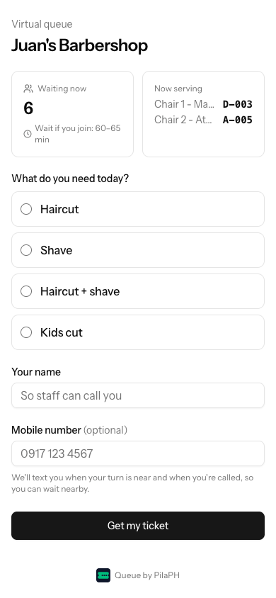
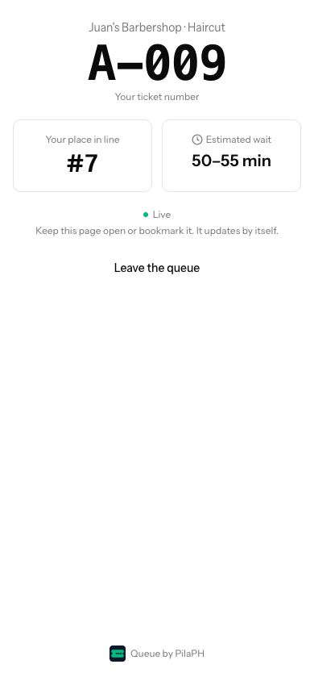
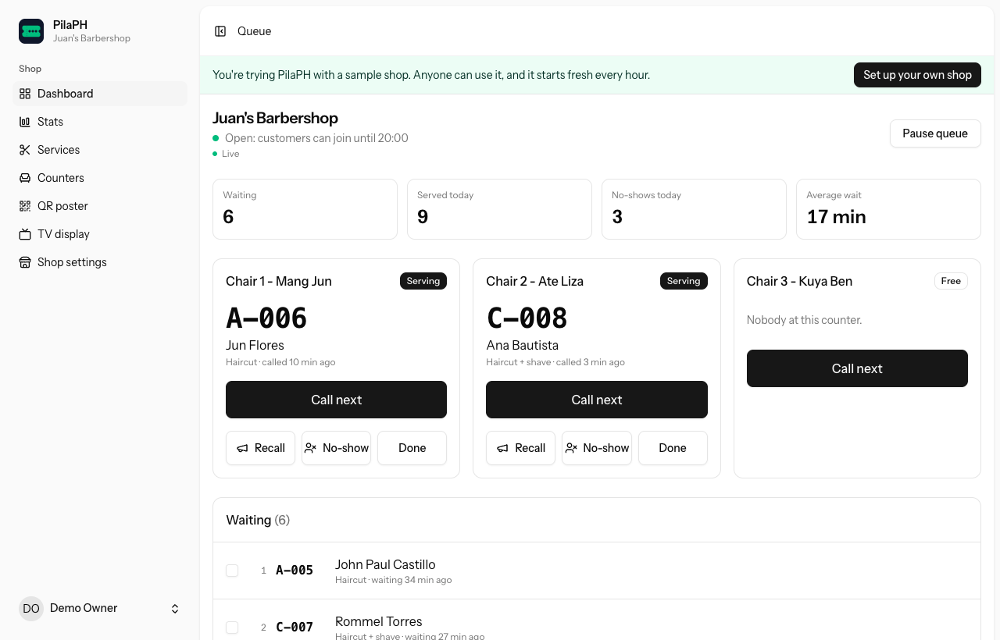
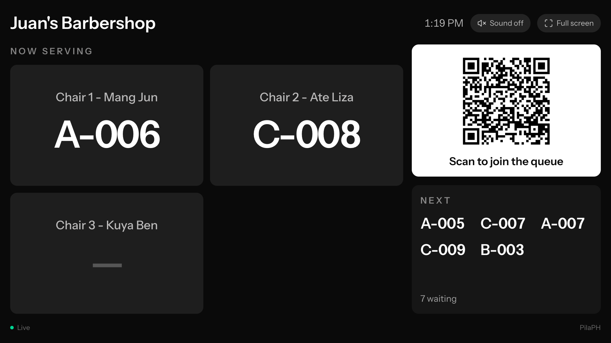
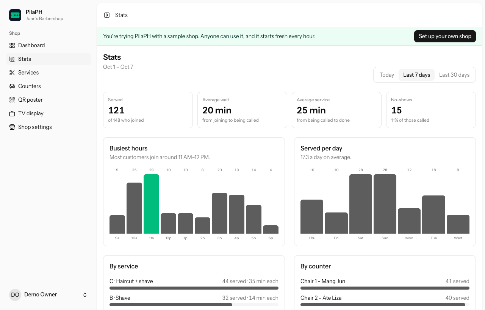

# PilaPH

A virtual queue for small Philippine businesses: barbershops, clinics and small offices.

Customers scan a QR code, pick a service and get a ticket number on their phone. They watch their place in line, get a text when it's almost their turn, and come back in time. The owner calls the next customer with one tap, and a TV shows who's being served.

| Join (customer's phone)                 | Ticket (customer's phone)                   | Owner dashboard                                    |
| --------------------------------------- | ------------------------------------------- | -------------------------------------------------- |
|  |  |  |

| TV display                             | Stats                                     |
| -------------------------------------- | ----------------------------------------- |
|  |  |

## Features

**For customers** (no app, no account)

- Scan the shop's QR code, choose a service, get a number like `A-024`.
- See their place in line and the estimated wait, live.
- An SMS when they're near the front and when they're called (optional phone number; Basic and Pro plans).

**For the owner** (installable as an app)

- Call next, recall, no-show and done for each chair or counter, from a phone.
- Push alerts when a customer joins, when the queue is almost full, and 30 minutes before the join cutoff.
- Services with their own ticket letters, chairs or counters, pause or limit the queue, a daily join cutoff.
- A printable QR poster, a TV "now serving" display with its own secret link, and stats: customers served, wait times, no-shows, busiest hours.
- Sign in with email and password, a passkey, or Google; optional two-factor codes.

**Built to hold up on a busy day**

- Two customers joining at the same moment never get the same number; two counters calling at once never get the same customer; a double-tapped "Call next" calls one person. Tested with real parallel processes.
- No names or phone numbers in anything public (broadcasts, the TV, the join page).
- Works on older phones (iOS 15 and up).

**Plans** (prices and limits in [config/plans.php](config/plans.php))

|                            | Free    | Basic ₱299/mo | Pro ₱799/mo |
| -------------------------- | ------- | ------------- | ----------- |
| Counters                   | 1       | 3             | no limit    |
| Customers a month          | 300     | no limit      | no limit    |
| SMS a month                | none    | 300           | 1,000       |
| Stats history              | 30 days | 6 months      | 12 months   |
| Shop photo, no PilaPH name | no      | yes           | yes         |

New shops get 14 days of Pro, with 50 texts. A Free shop's queue is never cut off mid-day: past 300 customers, joining closes from the next day. Customer names and phone numbers are erased a week after their visit, and history older than the plan keeps is deleted, every night (`php artisan data:prune`). Owners pay by GCash or Maya for now; `php artisan plan:set` switches the plan on, and `php artisan plan:list` shows every shop's plan.

Try it: the landing page's **Try the demo** button signs you in to a sample barbershop that starts fresh every hour.

## Tech

Laravel 13 (PHP 8.5) · Inertia + React 19 + TypeScript · Tailwind CSS 4 · PostgreSQL (Supabase) · Supabase Realtime Broadcast · Semaphore SMS · Web Push · Docker on Railway.

[Plan.md](Plan.md) is the full design: requirements, data model, the real-time and concurrency rules, and every decision made while building it.

Code layout: business operations are **Actions** (`app/Actions`, e.g. `CallNextTicket`, `CreateTicket`), outside systems and shared calculations are **Services** (`app/Services`, e.g. `SupabaseBroadcaster`, `QueueEstimator`), texts and push alerts are **Notifications**, and controllers stay thin.

## Run it locally

You need PHP 8.5 with Composer, Node 22 or later, and Docker.

```bash
cp .env.example .env
docker compose up -d postgres      # Postgres on port 5432 (plus a separate test database)
composer setup                     # installs, generates APP_KEY, migrates, builds assets
php artisan db:seed                # the demo barbershop with two weeks of history
php artisan storage:link           # local shop photos
composer run dev                   # app, queue worker, logs and Vite
```

Open **http://localhost:8100** (use `localhost`, not `127.0.0.1`: Google sign-in only accepts the registered address). Set `DEMO_ENABLED=true` in `.env` to get the **Try the demo** button.

Without any keys the app still works: texts go to the log (`SMS_DRIVER=log`), pages check for changes every 20 seconds instead of updating live, and the Google button is hidden. See `.env.example` for each optional key.

Timed jobs (the nightly reset, cutoff reminders, the demo reset, the nightly data clean-up) run with `php artisan schedule:work`.

## Tests

```bash
composer ci:check
```

Formatting, lint, TypeScript, Pint, PHPStan (level 7) and the Pest suite, including the concurrency tests. Tests use the separate `pilaph_test` database and never contact Supabase, Semaphore, Google or push services.

## Deploy

One Docker image runs the web server, queue worker and scheduler; [railway.json](railway.json) configures Railway (migrations before each deploy, health check, one replica that never sleeps). The database, live updates and photo storage are on Supabase.

Step by step, with every setting: **[docs/deploy.md](docs/deploy.md)**.
